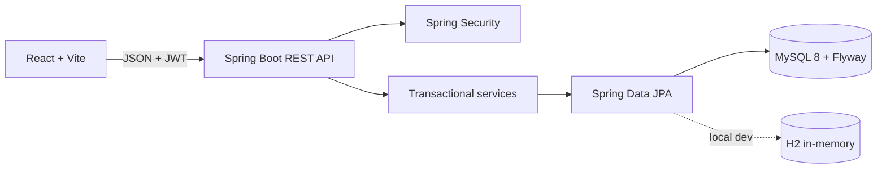

# Order Tracking and Fulfillment Setup

A full stack academic order management application for product catalog, customer checkout, stock reservation, warehouse fulfillment, simulated payments, and shipment tracking.

> The payment workflow is simulated. It does not charge real funds. Sample accounts and catalog data are created only in the local `dev` profile.

## Technology

- Java 21, Spring Boot 3.3.5, Spring Security, Spring Data JPA, Maven, Flyway, MySQL 8
- React 18, Vite 6, JavaScript, Tailwind CSS, React Router, Axios, Lucide, Recharts
- H2 in-memory database for zero-setup local development; MySQL profile for persistent data

## Features

- JWT login, BCrypt password hashing, customer registration, role-protected admin and warehouse workflows
- Admin user directory with role assignment and account enable/disable controls; last administrator protection
- Product and category administration, search, paging, low-stock reporting, warehouse inventory history
- Cart and server-calculated checkout, simulated payment record, order cancellation and stock restoration
- Database-backed sales analytics, product-specific warehouse alerts, and reliable cart clearing after checkout
- Warehouse picking, packing, dispatch, delivery, status transition validation, persistent history
- Customer order history and tracking; public tracking uses limited destination detail and hides operator emails
- Admin, warehouse, and customer dashboards backed by API queries
- Swagger UI at `/swagger-ui/index.html`

## Architecture



The backend is organized into controller, service, repository, entity, DTO, security, and configuration packages. The schema's core relationships are described in [docs/database-design.md](docs/database-design.md).

## Requirements

- JDK 21
- Node.js 20 or later and npm
- MySQL 8 for data that must persist between restarts (optional for local evaluation)
- Docker Compose is optional; Docker Desktop was not available in the inspected environment

Detected on this machine: Windows 11, Temurin Java 21.0.13.1, Maven 3.10.1, Node 26.13.1, npm 12.2.3, Git 2.56.1, and Oracle MySQL Community Server 8.4.9. Docker is not installed/on PATH. The local MySQL data directory is user-scoped and was not installed as a Windows service; `run-mysql.bat` starts it in a visible console when that directory exists.

## Run locally on Windows (quick start)

The default `dev` profile uses H2 and initializes sample data each time the backend starts. No database installation is needed for this mode.

1. Open PowerShell in the project directory.
2. Start the API:

   ```powershell
   cd backend
   .\mvnw.cmd spring-boot:run
   ```

   The API listens on `http://localhost:8080`. H2 console: `http://localhost:8080/h2-console` (JDBC URL: `jdbc:h2:mem:ordertrackingdb`, user `sa`, blank password).

3. In a second PowerShell window, start the frontend:

   ```powershell
   cd frontend
   npm ci
   npm run dev
   ```

4. Open `http://localhost:5173`.

Root shortcuts `run-backend.bat` and `run-frontend.bat` load their relevant values from the root `.env`; the frontend shortcut installs locked dependencies on first run. Without a `.env`, the backend shortcut uses the `dev` profile. For persistent MySQL mode, install MySQL Server 8.x with the [official Windows installation guide](https://dev.mysql.com/doc/refman/8.4/en/windows-installation.html). MySQL Installer can configure a Windows service; alternatively, `run-mysql.bat` starts an already initialized user-scoped data directory in a visible console. Keep the MySQL console open while the app uses that server. Then create the application database and its local application account in PowerShell (the JDBC URL also enables `createDatabaseIfNotExist`):

```powershell
mysql --version
mysql -u root -p -e "CREATE DATABASE IF NOT EXISTS ordertrackingdb; CREATE USER 'ordertracking_app'@'localhost' IDENTIFIED BY 'choose-a-unique-password'; GRANT ALL PRIVILEGES ON ordertrackingdb.* TO 'ordertracking_app'@'localhost';"
```

If `mysql` is not on `PATH`, run it from `C:\Program Files\MySQL\MySQL Server 8.4\bin\mysql.exe` (or the matching installed version). Set the environment in the backend PowerShell window:

```powershell
$env:SPRING_PROFILES_ACTIVE = 'mysql'
$env:SPRING_DATASOURCE_URL = 'jdbc:mysql://localhost:3306/ordertrackingdb?useSSL=false&serverTimezone=UTC&allowPublicKeyRetrieval=true&createDatabaseIfNotExist=true'
$env:SPRING_DATASOURCE_USERNAME = 'ordertracking_app'
$env:SPRING_DATASOURCE_PASSWORD = 'your-application-password'
$env:JWT_SECRET = 'replace-with-a-unique-secret-of-at-least-32-bytes'
$env:BOOTSTRAP_ADMIN_EMAIL = 'admin@example.com'
$env:BOOTSTRAP_ADMIN_PASSWORD = 'set-a-unique-password-of-12-characters-or-more'
.\mvnw.cmd spring-boot:run
```

Flyway applies the schema and catalog migrations in MySQL mode. On first startup, the optional bootstrap variables create one BCrypt-hashed administrator if that email is not already registered. Remove those two environment variables after that startup. The development initializer and sample accounts are disabled outside `dev`. Never use the development key or sample credentials in a deployed environment.

If using the MySQL profile, copy `.env.example` to `.env`, set the database username/password, replace the JWT value with a random secret of at least 32 bytes, choose `SPRING_PROFILES_ACTIVE=mysql`, and set the optional first-admin email/password. The launch shortcuts import those values without putting secrets in source code. On this machine port 8080 is occupied by another service; use `SERVER_PORT=8081` and set `VITE_API_URL=http://127.0.0.1:8081/api`. Local Vite origins on ports 5173–5175 are allowed by default; if Vite selects another port, add its exact origin to `CORS_ALLOWED_ORIGINS` before restarting the backend.

## Development accounts

These accounts exist only in the local `dev` profile:

| Role | Email | Password |
|---|---|---|
| Admin | `admin@ordertrack.com` | `Admin@123` |
| Warehouse manager | `warehouse@ordertrack.com` | `Warehouse@123` |
| Customer | `customer@ordertrack.com` | `Customer@123` |

Public registration always creates a customer. Staff accounts cannot be created by choosing a role in the registration form.

## API and database

- API reference: [docs/api-documentation.md](docs/api-documentation.md)
- Architecture: [docs/architecture.md](docs/architecture.md)
- Database tables and relationships: [docs/database-design.md](docs/database-design.md)
- End-user walkthrough: [docs/user-guide.md](docs/user-guide.md)
- Swagger UI: `http://localhost:8080/swagger-ui/index.html`
- OpenAPI JSON: `http://localhost:8080/v3/api-docs`
- Health check: `http://localhost:8080/actuator/health` (only health is exposed)

Primary tables: users, roles, user_roles, customer_addresses, categories, products, warehouses, warehouse_inventory, inventory_transactions, carts, cart_items, orders, order_items, order_status_history, shipments, fulfillment_records, and payments.

## Verify changes

```powershell
cd backend
.\mvnw.cmd test
cd ..\frontend
npm run build
```

Current tests cover service rules, cart persistence, checkout/cancellation stock changes, dashboard aggregates, and Flyway/JPA schema validation using H2 in MySQL compatibility mode. MySQL 8.4.9 was also used to apply Flyway V1–V3 and verify a live customer-to-delivery REST workflow. Browser end-to-end tests have not been run in this environment.

## Docker / deployment preparation

Copy `.env.example` to `.env`, replace the database and JWT examples, optionally set a one-time bootstrap admin email/password, and run `docker compose up --build` from the project root. Remove the bootstrap admin variables from `.env` after the first successful MySQL startup. The Compose frontend is exposed at `http://localhost:3000`, API at `http://localhost:8080`. Docker is unavailable in this environment, so Compose has not been executed here.

For Vercel, select `frontend` as the project root and set `VITE_API_URL` to the hosted backend's `/api` URL; `frontend/vercel.json` supports client-side routes. For a Docker-capable Java host such as Render, deploy `backend/Dockerfile` as a web service and provide `PORT` (or `SERVER_PORT`), `SPRING_PROFILES_ACTIVE=mysql`, `SPRING_DATASOURCE_URL`, `SPRING_DATASOURCE_USERNAME`, `SPRING_DATASOURCE_PASSWORD`, `JWT_SECRET`, and `CORS_ALLOWED_ORIGINS`. Bootstrap the first admin with the two variables above and remove them after startup. Provide a managed MySQL 8 database.

### Temporary public preview

The production frontend is deployed at https://order-tracking-fulfillment.vercel.app. The site and catalog API were checked through Vercel; customer registration, login, and an authenticated endpoint also succeeded. Currently the Vercel `/api` rewrite points to https://rescue-less-stake-orders.trycloudflare.com, a temporary Cloudflare Quick Tunnel to the local Spring Boot/MySQL services. This keeps the API working while this PC and those services are online, but it is not durable backend hosting; the tunnel may stop or its hostname may change. If it changes, update `frontend/vercel.json` and redeploy. Set up a hosted Java backend and managed MySQL before relying on the site for production orders. For a local preview after building, run `npm run preview:fullstack` in `frontend` (the backend must be available on port 8081).

## GitHub

The workspace has a local Git repository initialized on `main`, with project files staged for review. No remote is configured and nothing has been pushed. Review the staged files, configure your author identity if needed, then commit and connect your own GitHub repository:

```powershell
git config user.name "Your Name"
git config user.email "you@example.com"
git commit -m "Build order tracking and fulfillment application"
$repoUrl = Read-Host "GitHub repository URL"
git remote add origin $repoUrl
git push -u origin main
```

`.gitignore` excludes local environment files, build output, and dependency directories. Do not commit `.env`.

## Screenshots

Add screenshots of the dashboard, catalog, checkout, fulfillment queue, and tracking timeline here after capturing them locally.

## Extension ideas for MCA semester 4

- Real payment provider behind a payment adapter and verified webhook processing
- Barcode-based picking, package label generation, and carrier integration
- Email/SMS notifications and delivery proof
- Multi-warehouse allocation optimization and replenishment forecasting
- Audit log exports, advanced reports, and automated API/browser tests

## License

No license has been selected yet.
